# Paideia

[](https://github.com/yureiblack/paideia/actions/workflows/ci.yml)

A local-first adaptive learning workspace. You create one environment per
subject and upload your lecture PDFs into it. From them, Paideia builds a
summary, a knowledge map of the concepts and how they connect, a learning
roadmap, practice questions and a review schedule. Everything it derives
from the material cites the passages it rests on, and it keeps all of it up
to date by itself.

**When you add material, the environment improves itself.** New concepts and
relationships appear, the roadmap and the summary adjust, and only the work
the new material affects is redone.

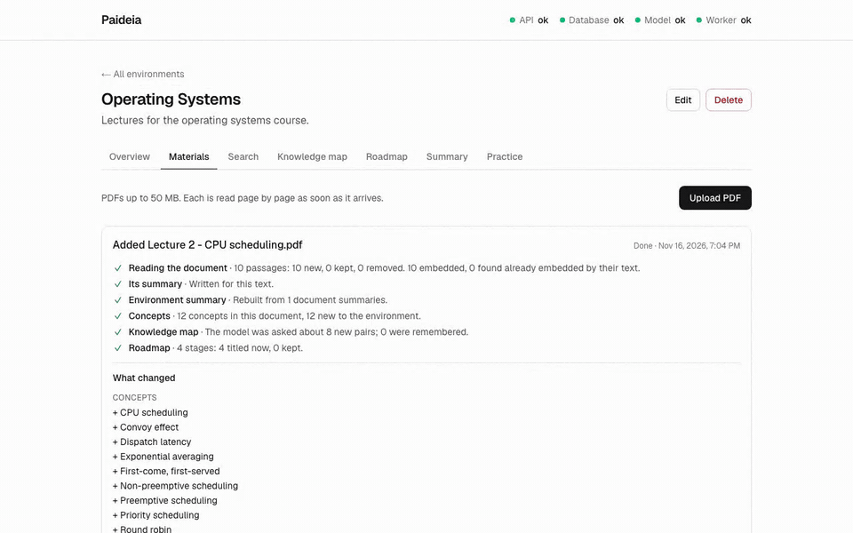

*Adding a second lecture to an environment that already has one. Everything
is real, including the local language model; the waits for the model are sped
up.*

Everything runs on your own machine: Postgres, the search models and the
language model. Once the models are downloaded, it works offline, and your
material and answers never leave the machine.

## Contents

- [The problem](#the-problem)
- [What it does](#what-it-does)
- [Why this is not a chatbot](#why-this-is-not-a-chatbot)
- [Architecture](#architecture)
- [Data model](#data-model)
- [Processing pipeline](#processing-pipeline)
- [Incremental updates](#incremental-updates)
- [Retrieval](#retrieval)
- [Learning engine](#learning-engine)
- [Evaluation](#evaluation)
- [Testing](#testing)
- [Running it locally](#running-it-locally)
- [Screenshots](#screenshots)
- [An example session](#an-example-session)
- [Trade-offs and rejected alternatives](#trade-offs-and-rejected-alternatives)
- [Why these technologies?](#why-these-technologies)
- [Future work](#future-work)
- [Documentation](#documentation)
- [Repository layout](#repository-layout)

## The problem

A course reaches a student one lecture at a time. After each one, the same
questions come back:
- What does the material say?
- How do its ideas connect?
- What should I learn first?
- What should I practise today, and what is due for review?

A chat assistant answers the question you ask, if you know what to ask. It
keeps no picture of your material or of how you are doing, and each answer
starts again from nothing. Flashcard and note tools keep state, but you build
all of it by hand, and nothing updates when the next lecture arrives.

Paideia keeps the state. Each environment's summary, map, roadmap, practice
and schedule are stored and cited, and the system maintains them when the
material changes, not when you remember to ask.

## What it does

Each environment has seven tabs:

| Tab | What it shows |
|---|---|
| **Overview** | Today's study plan, worked out from your answers: concepts to strengthen, reviews due, the next stage to learn, new material to skim. Each part has its reason and an estimate of the time it takes. Also each stage's progress, and the map in a few lines. |
| **Materials** | Every PDF, read page by page. Every change is followed step by step, then reported: what it added, removed and updated, and what it left as it was. |
| **Search** | Keyword search and search by meaning, fused and then reranked. Every result is a citation. "Show in page" opens the passage, highlighted in its page, and "Show scoring" shows how each result was ranked. |
| **Summary** | A summary of all the material, built from each document's summary. Every key point cites its passages. |
| **Knowledge map** | The concepts, with definitions and the passages that explain them. For each concept: what it builds on, what builds on it, its parts, and what it is related to. Every relationship cites the passages it was found in. |
| **Roadmap** | The material as an ordered path in stages. Each concept shows what it builds on, and where it is taught. |
| **Practice** | Four kinds of items per concept, mixed within a session. Each answer shows its source and when the concept comes back. Also how each concept is going, weakest first, and past sessions. |

## Why this is not a chatbot

There is no chat box. The language model is one component with narrow jobs,
and the code around it decides everything that has to be right every time:

| What | Decided by |
|---|---|
| What a document says | The model writes a summary. Each key point must cite passages it was given, and the citation points at a stored passage. |
| Which concepts exist | The model proposes. The backend normalizes the names by fixed rules, checks every proposal, and merges concepts by name, never by alias. |
| Which concepts might be related | Fixed rules: two concepts are a candidate pair only when a passage connects them. |
| How a pair is related | The model picks one of six statements about the pair. Below a confidence of 0.5, it counts as no relationship. |
| The order to learn in | Fixed rules, from the graph. The model only writes each stage's title. |
| Which practice items are kept | The model writes them. The backend keeps an item only if its answer is found in the passages it cites. |
| Whether an answer is right | The stored answer, or the learner after seeing it. Never the model. |
| When a concept comes back, and today's plan | Fixed rules, from the answers. |
| What a change of material redoes | Fingerprints of each result's inputs. |

Everything the model writes is stored with a fingerprint of what it was
written from, and the model and prompt version that wrote it. Asking again
for the same inputs returns the stored result. New inputs write a new
version, and the old one is kept. Prompts are versioned files, locked by a
checksum, and never edited once released.

## Architecture

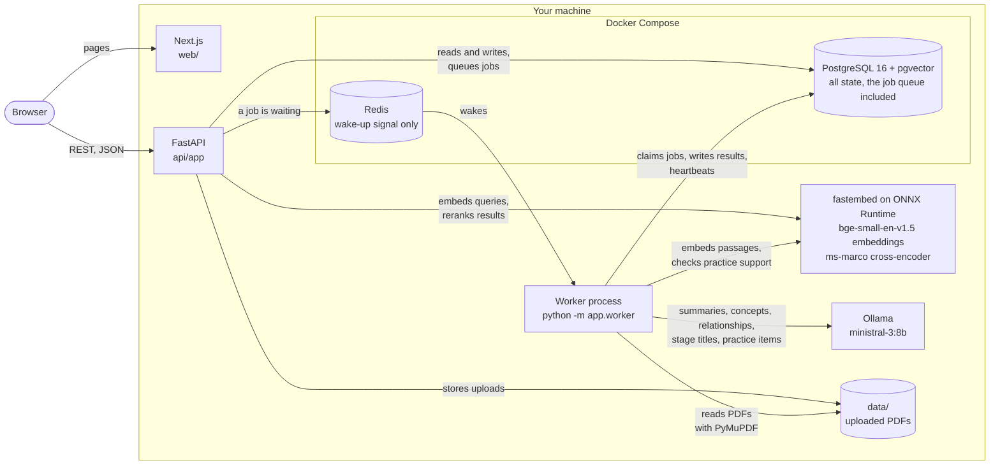

- **Three processes of its own:**
  - the page, in Next.js;
  - the API, in FastAPI;
  - a worker, for everything slow.

  Postgres and Redis run in Docker. Ollama runs natively, because Docker on a
  Mac cannot use the GPU.
- **Postgres holds all the state:**
  - the relational data;
  - the passages' full-text index and their vectors (pgvector, with an HNSW
    index);
  - the job queue.
- **The worker.** Reading a document and the model's work take seconds to
  minutes, so they run as jobs, outside any request.
  - A restart of the API loses nothing.
  - A job whose worker stops is noticed by its missing heartbeat and run
    again, up to three attempts in all.
  - Any job can be cancelled.
  - The database refuses a second job doing what a queued one already does.
- **Redis only wakes the worker.** A lost signal slows pickup; it never
  loses a job.
- **Two lanes.** Reading documents comes first, and the model's work runs
  one task at a time, since there is one local model.
- **Logs.** The API and the worker log JSON lines. Every request's id comes
  back in an `X-Request-ID` header and in every error, and it follows the
  jobs the request queued into the worker's log.

## Data model

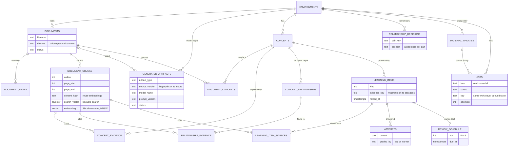

Three ideas carry the model:

- **Evidence is a row, not a string.** Concepts, relationships and practice
  items each link to the exact passages behind them, through their evidence
  tables. A passage, in turn, knows its document, its pages and its
  character offsets. Every citation can therefore be opened in its page.
- **What the model writes is keyed by what it read.** A generated artifact's
  `source_version` fingerprints its inputs. One row exists per inputs, model
  and prompt version, so the same request never writes twice, and history is
  never overwritten.
- **The learner's state is not stored apart from the answers.** How each
  concept stands is worked out from the attempts every time it is read, so
  it cannot drift from them. The review schedule orders each concept's items.

The schema is built only by Alembic migrations. CI checks that the models and
the migrations agree.

## Processing pipeline

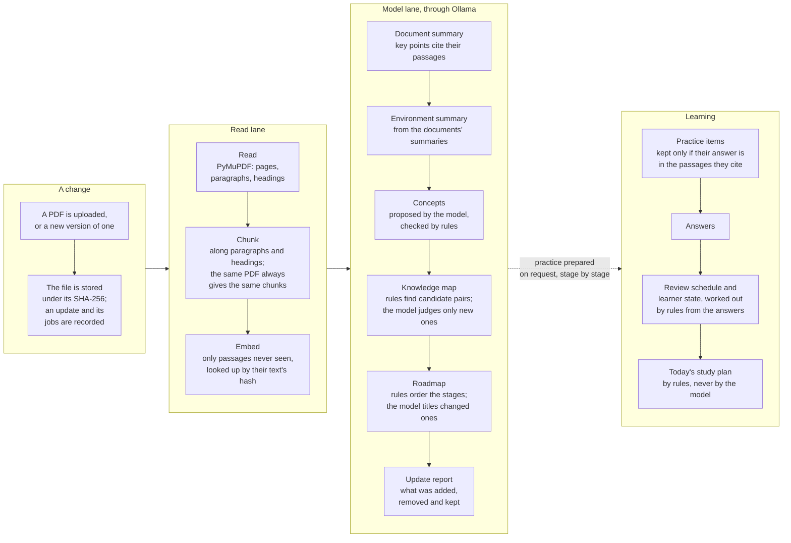

1. **Upload.** The PDF is streamed to disk as the raw request body, checked
   (a PDF, at most 50 MB by default) and stored under its SHA-256. The same
   file twice in one environment is refused. An update record and its jobs
   are written.
2. **Read.** PyMuPDF extracts each page's paragraphs and headings. Running
   headers, footers and page numbers are dropped, and words broken across
   lines are rejoined. A PDF longer than the page limit, 1,000 by default,
   fails here.
3. **Chunk.** Passages follow paragraphs and headings: about 800 characters,
   at most 1,200. Each passage records its pages and character offsets. Its
   id derives from its content, so reading the same PDF again gives the
   same passages.
4. **Embed.** Each passage is embedded locally with bge-small-en-v1.5, unless
   a passage with the same text already has a vector, in any document.
5. **Derive.** Then, in order: the document's summary, the environment's
   summary, the concepts, the knowledge map and the roadmap. Each step finds
   its inputs, and does nothing if a result for exactly those inputs exists.
6. **Report.** The update is summed up: concepts and relationships added and
   removed, passages new, kept and removed, embeddings computed and reused,
   and what was updated or left unchanged.

Practice is prepared when the learner asks for it, stage by stage, as its own
background job.

## Incremental updates

Adding, replacing or deleting a document redoes only what it changes
([record 17](docs/architecture/17-incremental-updates.md)):

- **Embeddings are reused by text** across every document, so a passage
  already seen is never embedded twice.
- **A document can be replaced by a new version.** It keeps its place, and
  its unchanged passages keep their embeddings, their concept evidence and
  the practice built on them.
- **Practice follows the passages it cites.** An item is retired only when
  those passages change. It is kept, with its answers, as history.
- **The model is asked only about what is new:**
  - relationship decisions are remembered by pair, so a new lecture asks
    only about new pairs, and deleting one asks nothing;
  - stage titles are remembered by stage, so only changed stages get new
    ones.
- **Results are keyed by their inputs.** The environment's summary is
  rebuilt only when a document's summary changes. Going back to earlier
  material shows the results written for it.
- **Every change is reported.** Each change is a recorded update, followed
  step by step on the Materials tab. Its report compares the environment
  before and after.

## Retrieval

Search runs two retrievers over the environment's passages, then merges and
reranks their results ([records 04 to 07](docs/architecture/README.md)):

1. **Keyword search,** in Postgres full-text search: stemmed, headings
   weighted, any word may match, ranked by `ts_rank`. It catches exact terms
   such as "TLB" or "Belady's anomaly". A query written with search syntax
   ("a phrase", `OR`, `-word`) is matched exactly.
2. **Semantic search,** by cosine distance between bge-small-en-v1.5 vectors,
   through pgvector's HNSW index. Iterative scans keep searching the index
   until enough passages of this environment are found, so a small
   environment beside a large one still gets its results.
3. **Reciprocal Rank Fusion** merges the best 30 from each list by position
   alone, with the usual constant of 60. The two kinds of score never need
   to be compared.
4. **A cross-encoder reranks** the best 30 of the merged list, reading the
   query and each passage together (ms-marco-MiniLM-L-6-v2). The best 10 are
   returned.

Every result is a citation: the environment, the document, the document's
version (its file's SHA-256), the pages, the heading, the passage and its
position. "Show scoring" returns each candidate's keyword, semantic, fusion
and rerank scores.

## Learning engine

- **Concepts** ([record 11](docs/architecture/11-concepts.md)):
  - The model proposes the concepts each section teaches, each with a
    definition, other names and its evidence passages.
  - Names are normalized by fixed rules, so "Threads" and "Thread" are one
    concept.
  - A description passed off as another name is dropped.
  - Only passages the model was actually given count as evidence.
- **Knowledge map** ([record 12](docs/architecture/12-knowledge-graph.md)):
  - Two concepts form a candidate pair when one passage is evidence for one
    of them and is also evidence for, or names, the other, in one lecture or
    across lectures.
  - The model chooses one of six statements per pair: either one must be
    understood before the other (two statements), either one is part of
    the other (two), they are related, or the passages show nothing.
  - There is at most one relationship per pair, and each cites its passages.
  - In prototypes, a model proposing relationships freely produced
    well-formed nonsense, which is why pairs come from the passages.
- **Roadmap** ([record 13](docs/architecture/13-learning-roadmap.md)):
  - Stages are groups of concepts related within the lecture that first
    teaches them.
  - Stages follow the prerequisites between them, then reading order.
  - Within a stage, prerequisites and wholes come before what depends on
    them.
  - Prerequisites that loop are kept together and shown as such.
  - A stage holds at most eight concepts.
  - The model writes only the titles.
- **Practice** ([record 14](docs/architecture/14-practice-engine.md)):
  - For each concept, the model writes a short answer, a multiple choice, a
    true/false and a flashcard from the concept's own passages.
  - The backend keeps an item only if its text is plain and its answer
    scores at least 0.5 against the passages it cites, by the same
    cross-encoder that reranks search.
  - Multiple choice and true/false are checked against the stored answer.
    Short answers and flashcards are marked by the learner after seeing the
    answer.
- **Spaced review** ([record 15](docs/architecture/15-learner-state.md)):
  - Reviews are 1, 2, 4, 8, 16, then 32 days apart.
  - A recall moves a concept up one step, at most once per 12-hour sitting,
    and a miss brings it back the next day.
  - "Due today" is the learner's own day, in their time zone.
  - Sessions take two items from each due concept, mixed, at most ten.
- **Study plan** ([record 16](docs/architecture/16-study-plan.md)):
  - Worked out afresh on every read, in this order:
    1. strengthen what was missed lately;
    2. review what is due;
    3. learn the next stage not yet practised;
    4. skim material added in the last week.
  - Each session has a reason from a template, and an estimate: reading at
    200 words a minute, answering at the learner's own pace once known.
  - An optional time budget moves what does not fit to "With more time".

## Evaluation

The search and the summaries are measured by a benchmark
([record 20](docs/architecture/20-evaluation.md),
[full report](docs/evaluation/retrieval-benchmark.md)).

**The setup:**
- **Corpus:** ten operating systems lectures written for it, read by the
  app's own pipeline: 29 pages, 92 passages.
- **Questions:** 80 of them, labelled by quoting the passages that answer
  them.
- **Each run:** every question is asked three times per method, in three
  fresh builds of the database.
- **No number is typed by hand:** a script writes every figure in the report.

Retrieval, on those 80 questions:

| Method | Recall@10 | MRR@10 | Right passage first | Median time |
|---|---|---|---|---|
| Keyword search alone | 0.944 | 0.846 | 78% | 1.9 ms |
| Semantic search alone | 0.969 | 0.818 | 74% | 8.9 ms |
| Both, fused | 0.981 | 0.848 | 77% | 12.3 ms |
| **Fused and reranked (the app)** | **0.994** | **0.925** | **90%** | 619.1 ms |

- **Reranking is the largest single gain.** It puts the right passage first
  for 90% of questions instead of 77%, at about 0.6 s per search on a
  laptop.
- **Questions phrased in other words** than the material are where the
  methods differ most. MRR@10 is 0.605 for semantic search alone, 0.704 for
  keyword search alone and 0.823 for the app.

Summaries of the ten lectures by the local model:

| Measure | Result |
|---|---|
| Key points grounded in at least one of their citations | 100% of 70 |
| Key facts covered | 98% of 50 |
| Citations that support their point, by the automatic judge | 89% of 83 |
| The same, corrected by a review of 30 sampled citations | about 68% |

The judge is the reranker, which is lenient: it accepted citations the
review rejected, and never the reverse. The rejected citations share a
pattern: the point is true of the document, but the passage cited is a
neighbouring one, not the one that says it.

**What these numbers do not show:**
- The corpus is small, so recall among thousands of passages would be lower.
- The questions were written alongside the corpus.
- The labels and the review were checked in a second pass, **not by an
  independent person**.
- Latency is one laptop, with one person searching.

## Testing

([record 22](docs/architecture/22-testing-and-ci.md))

- **Backend:** 611 tests with pytest, on a real Postgres with pgvector.
  - Each test is rolled back, and test PDFs are built in code.
  - The suite covers unit, API, database integration, ingestion,
    retrieval, scheduling and job tests.
  - Coverage, lines and branches, is 90%, reported but never enforced.
  - mypy checks `app/`.
- **Frontend:** 22 component tests with Vitest and Testing Library.
  - They run the real API client, with each test supplying the API's
    answers.
  - They query the page by role and name, and use no snapshots.
- **End to end:** one Playwright journey through the running app.
  - It goes from creating an environment to a second PDF updating it, in
    twelve steps.
  - Everything in it is real except the language model, which is a
    stand-in.
- **CI:** GitHub Actions runs three jobs on every pull request and every
  push to main: backend, frontend, end to end.
  - A failing test is never retried.
  - Its log is kept, which is how a flaky search test was traced to dead
    entries in the vector index.

## Running it locally

You need Docker Desktop, Python 3.13, Node 22 with pnpm, and Ollama (on a
Mac, `brew install ollama`).

**Once,** from the repository root:

```sh
docker compose up -d                  # Postgres and Redis
cp .env.example .env                  # then set DATABASE_URL as its comment says
python3 -m venv .venv && source .venv/bin/activate
pip install -r api/requirements.txt
(cd api && alembic upgrade head)      # create the tables
(cd web && pnpm install)
ollama pull ministral-3:8b            # the language model, about 6 GB
```

**Every time,** from the repository root. First the services:

```sh
docker compose up -d                  # Postgres and Redis
brew services start ollama            # the language model, if it is not already running
```

Then three processes, each in its own terminal:

```sh
source .venv/bin/activate && cd api && uvicorn app.main:app --reload   # 1: the API, on :8000
source .venv/bin/activate && cd api && python -m app.worker            # 2: the worker
cd web && pnpm dev                                                     # 3: the page, on :3000
```

Then open the app:

```sh
open http://localhost:3000            # on a Mac; elsewhere, open the address in a browser
```

The masthead says "All systems ok" once the API, the database, the language
model and the worker all answer; click it to see each one. The theme (Auto,
Light or Dark) is beside it.

To stop, press Ctrl+C in each of the three terminals, then:

```sh
docker compose stop                   # keeps the data; docker compose up -d brings it back
```

After pulling changes, run `(cd api && alembic upgrade head)` if they add a
migration, and the install lines again if they change `requirements.txt` or
`package.json`.

[docs/setup.md](docs/setup.md) has every step in full, the settings, the
development commands, and how to run each kind of test.
[docs/api.md](docs/api.md) lists every endpoint. The interface's design is
in `design/paideia.pen`, which opens in [Pencil](https://pen.dev).

## Screenshots

The demo environment below holds two lectures from the benchmark's corpus:
CPU scheduling, then deadlock. Everything was written by the real local
model.

**Overview: the numbers at a glance, today's plan, each stage's progress and the summary**

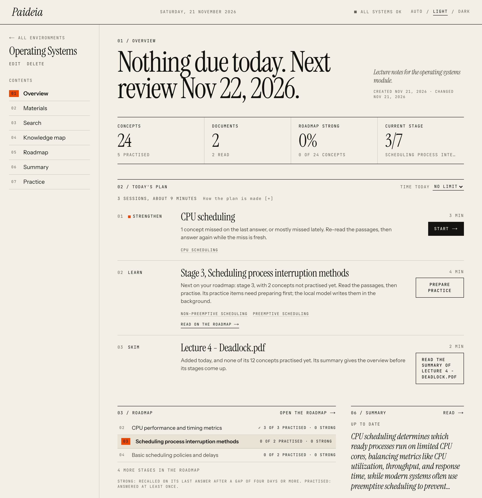

**Materials: what adding the second lecture changed**

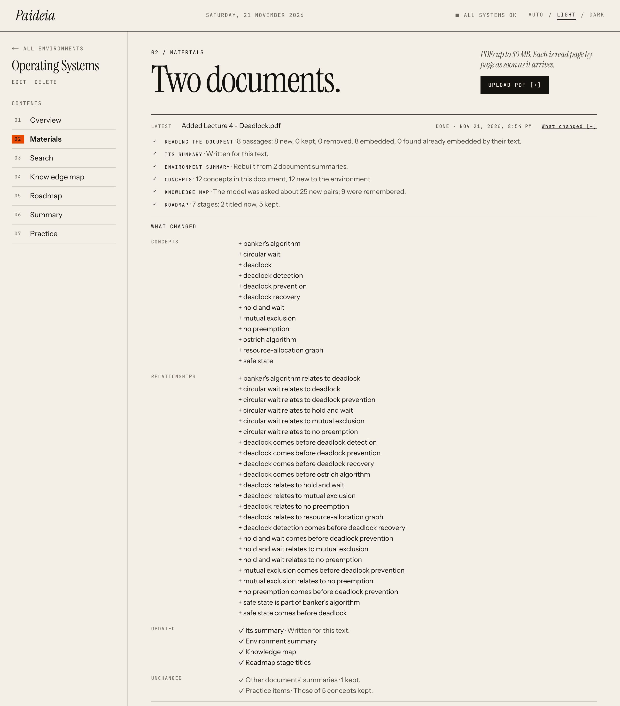

**Search: a question in other words, the best passage shown in its page**

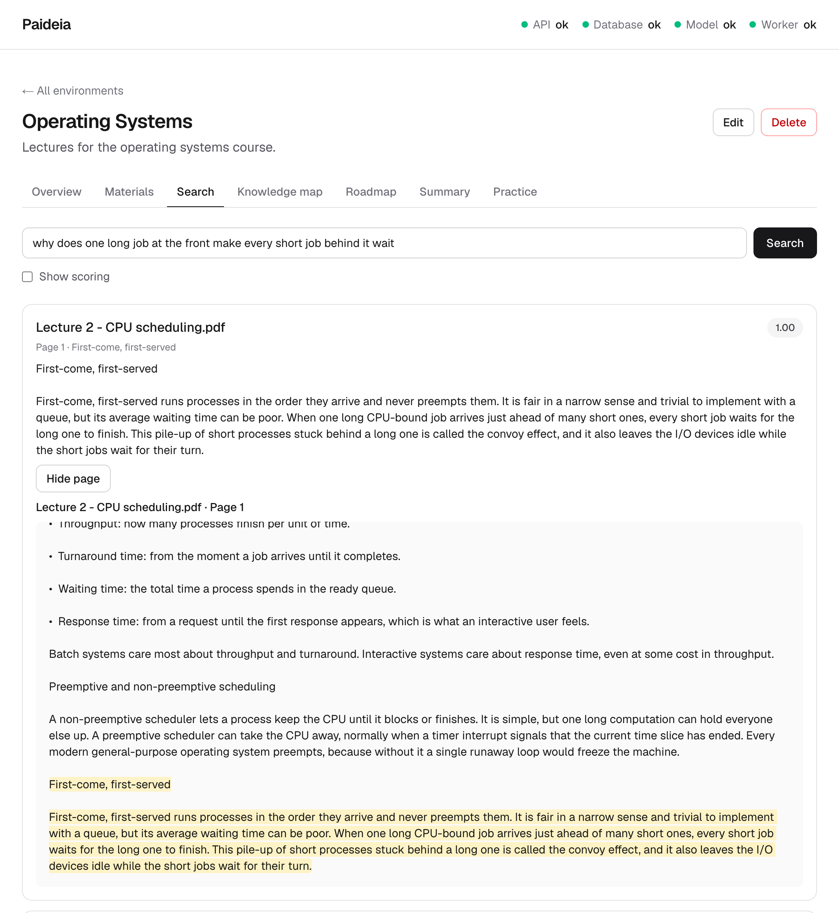

**Knowledge map: a concept with what it builds on and what it relates to**

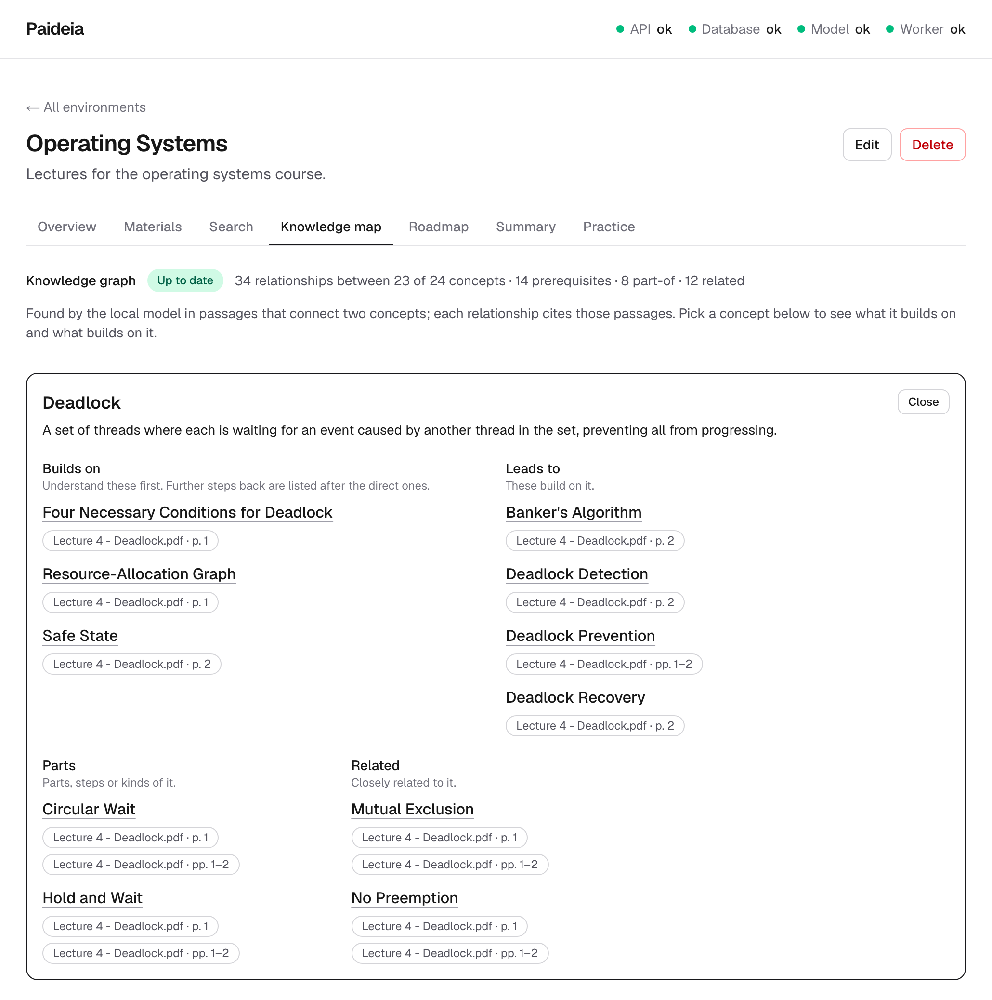

**Roadmap: the first stages, each concept with its passages and how the learner stands on it**

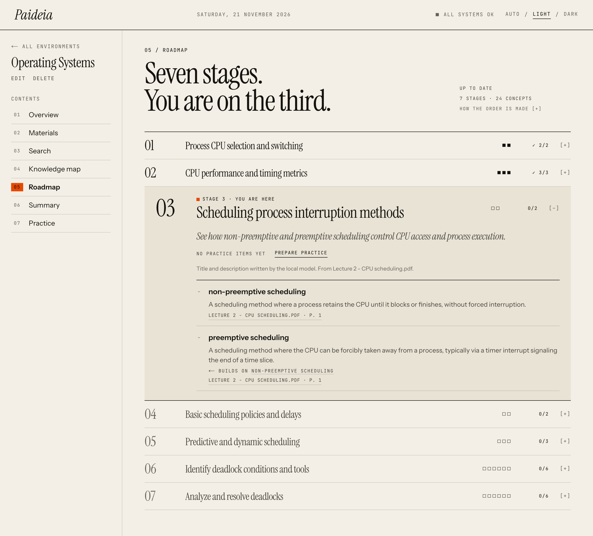

**Practice: an answer with its source and when the concept comes back**

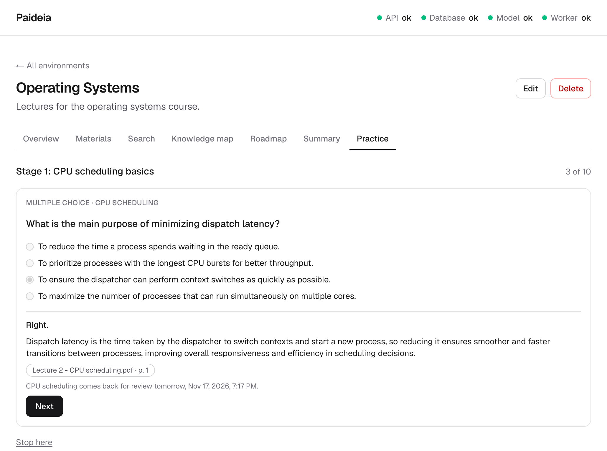

**Summary: the subject's summary, each key point citing its passages**

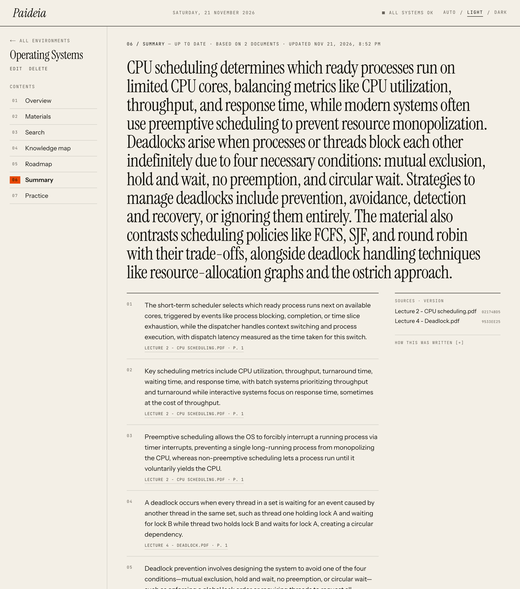

## An example session

This is the run behind the screenshots and the demo above, on an Apple M3 Pro
with the real local model. The times are the background jobs' own.

1. **Create an environment,** "Operating Systems".
2. **Upload "Lecture 2 - CPU scheduling.pdf",** three pages. It is read in
   about a second; the model's work takes 136 seconds.
   - It is cut into 10 passages, all embedded.
   - Its summary and the environment's summary are written.
   - 12 concepts are proposed and kept, from "Round robin" to "Exponential
     averaging".
   - The model is asked about 8 candidate pairs. It keeps 7 relationships,
     such as "Time quantum is part of Round robin" and "Exponential averaging
     comes before Shortest job first".
   - The roadmap has 4 stages, each titled by the model.
3. **Prepare practice** for the first two stages: 18 items for 5 concepts, in
   58 and 38 seconds.
4. **Answer a session** of seven items, some right, some missed. The Overview's
   plan now starts with "Strengthen: Scheduling metrics and Preemptive
   scheduling", the two concepts missed.
5. **Upload "Lecture 4 - Deadlock.pdf".** The model's work takes 167 seconds.
   - The new lecture is cut into 8 passages, all embedded.
   - It gets its own summary. The environment's summary is rebuilt from both
     documents' summaries, and the first lecture's summary is kept as it
     was.
   - 12 new concepts are added.
   - The model is asked about the 27 new candidate pairs only. The first
     lecture's 8 are remembered, not asked again. All 27 become
     relationships, such as "Circular Wait is part of Deadlock" and "Four
     Necessary Conditions for Deadlock comes before Deadlock".
   - The roadmap grows to 6 stages: the 2 new ones are titled, and the 4
     existing titles are kept.
   - The practice of the 5 practised concepts is kept, with its answers.
   - The plan adds "Skim: Lecture 4 - Deadlock.pdf", since none of its 12
     concepts has been practised yet.
6. **Search** "why does one long job at the front make every short job behind
   it wait". The question never names the convoy effect, yet the passage on
   first-come, first-served comes first, scored 1.00 by the reranker (0.996
   before rounding).

No passage in either lecture names a concept of the other, so no relationship
crosses the two. The end-to-end test checks that case with two documents
that do connect: the second one's passage on page faults names processes.

## Trade-offs and rejected alternatives

Each decision record says what was tried or rejected, and why. The larger
ones:

| Chosen | Instead of | Because | Record |
|---|---|---|---|
| Vectors in Postgres, with pgvector | A separate vector database | A second system to run, back up and keep consistent, for a dataset that will stay small. Postgres also combines vector and full-text search in one query. | [01](docs/architecture/01-foundation.md) |
| The backend proposes pairs, the model classifies them | The model proposing relationships freely | Prototypes gave well-formed nonsense and contradictions. Abstract "A" and "B" labels reversed about a third of directions; real names in full sentences cut that to about 3 in 20. | [12](docs/architecture/12-knowledge-graph.md) |
| Rules order the roadmap | The model ordering it | A deterministic order from the graph is the same every time, and each step traces back to cited prerequisites. | [13](docs/architecture/13-learning-roadmap.md) |
| Stages from groups of related concepts within a lecture | Stages by depth in the prerequisite graph | Prerequisites were too sparse: depth alone would have put 29 of 35 concepts in stage 1. | [13](docs/architecture/13-learning-roadmap.md) |
| Grading by the stored answer or the learner | The model grading answers | Slow and unreliable, and the model must not decide outcomes. | [14](docs/architecture/14-practice-engine.md) |
| Learner state worked out from the answers | A table of each concept's state | It would be a second copy of the truth. | [15](docs/architecture/15-learner-state.md) |
| Reasons from templates in the study plan | Reasons written by the model | Templates are instant and cannot drift from the numbers. | [16](docs/architecture/16-study-plan.md) |
| A Postgres job table and a small worker | Celery, RQ or arq | Celery was ruled out by the project's plan. RQ and arq keep their job state in Redis, apart from the data, and arq is asynchronous where the services are not. | [18](docs/architecture/18-background-jobs.md) |
| fastembed on ONNX Runtime | Sentence Transformers on PyTorch | About 183 MB, the same packages on Mac and Linux. PyTorch on Linux brings about 1 GB of GPU libraries to every CI run. | [05](docs/architecture/05-embeddings.md) |
| Any word may match in keyword search | Every word must match | With every word required, 16 of 32 test questions found nothing. | [06](docs/architecture/06-hybrid-retrieval.md) |
| A small cross-encoder, MiniLM-L-6 | bge-reranker-base | The larger model got one more question of 32 right, at 12 times the size and 8 times the time. | [06](docs/architecture/06-hybrid-retrieval.md) |
| A 503 when the reranker cannot load | Falling back to the fused order | Results would quietly get worse, with no one knowing why. | [06](docs/architecture/06-hybrid-retrieval.md) |
| A corpus written for the benchmark | A textbook or Wikipedia | A textbook cannot be committed, and Wikipedia's share-alike licence would bind the repository. | [20](docs/architecture/20-evaluation.md) |
| No accounts | Authentication, rate limits | One learner on their own machine. CORS limits which pages may call the API. | [21](docs/architecture/21-reliability.md) |
| Coverage reported, no snapshot tests | A coverage target, snapshots | Snapshots fail on every deliberate change of wording, and say nothing about whether the page works. | [22](docs/architecture/22-testing-and-ci.md) |

## Why these technologies?

| Technology | Why |
|---|---|
| **PostgreSQL 16 with pgvector** | One database holds the relational data, the full-text index, the vectors and the job queue: one system to run and back up. HNSW serves approximate nearest-neighbour search, by cosine distance, the measure the embedding model is trained for. |
| **Postgres full-text search** | Stemming, weighted headings and a GIN index, with the search vector computed by Postgres itself, so it can never drift from its text. |
| **FastAPI and Pydantic** | Reading PDFs, embedding and calling the model are Python work. One Python service avoids a second service and the boundary between them. It gives typed request and response shapes and generated documentation. Pydantic also validates every answer the model gives against its schema. |
| **SQLAlchemy 2 and Alembic** | Explicit relational models, and migrations that run the same way on a laptop, in CI and in a deployment. CI checks that the models and migrations agree. |
| **PyMuPDF** | Fast, page-aware extraction, with paragraphs and headings: a 300-page file is read in under 3 seconds. |
| **fastembed on ONNX Runtime** | Local embeddings and reranking without PyTorch: about 183 MB, with the same packages on Mac and Linux. |
| **bge-small-en-v1.5** | 384 dimensions, a window long enough for a whole passage, and an MIT licence. bge-base was three times slower and no better here. |
| **ms-marco-MiniLM-L-6-v2** | The best ranking for its size among the four rerankers measured, at 87 MB, under Apache-2.0. |
| **Ollama with ministral-3:8b** | A local model: no API cost, works offline, and results can be reproduced. Among the 8B models with an Apache-2.0 licence that were tried, its summaries had the highest coverage. |
| **Redis** | Only wakes the worker when a job is queued, so a lost signal slows pickup and never loses work. |
| **Next.js, React and Tailwind** | A mature React application structure for a dashboard, with styles kept next to the components that use them. |
| **TanStack Query** | Each section's data is cached, retried, and polled while background work runs, so progress shows without reloading. |
| **Docker Compose** | One command starts the same Postgres and Redis on any machine. Ollama stays outside it, for the GPU. |
| **pytest, Vitest, Playwright, mypy, Ruff, GitHub Actions** | Tests at every level: the backend against real Postgres, components against the real API client, and the whole app in a real browser. CI runs them all on every change. |

## Future work

Known limits, each stated in its decision record:

- **Maths is in progress.** Maths written as LaTeX is typeset and checked
  ([24](docs/architecture/24-maths-notation.md)). Reading maths from PDFs
  with the local vision model, linear algebra exercises the backend solves
  and marks, and a maths benchmark are planned as phases 26 to 28. Until
  then, a PDF's formulas reach the passages as its text layer has them,
  which for matrices is a row of numbers.

- **One learner per installation,** with no accounts, and one worker.
  Several workers would need the model lock moved into Postgres or Redis,
  and settling what a stopped job left unfinished assumes one worker
  ([18](docs/architecture/18-background-jobs.md),
  [21](docs/architecture/21-reliability.md)).
- **PDFs with a text layer only.** A scanned PDF is read with no text; OCR
  was out of scope ([03](docs/architecture/03-pdf-ingestion.md)). Keyword
  search uses an English dictionary.
- **The chunker splits a paragraph that crosses a page break** into two
  passages. The benchmark found one citation harmed by it. The fix is to be
  judged by the benchmark, before and after
  ([20](docs/architecture/20-evaluation.md)).
- **Citations sometimes name the neighbouring passage.** By a review of a
  sample, about 68% of summary citations support their point; most of the
  rest cite a passage next to the right one. Citing the exact passage is the
  clearest improvement left for the summaries.
- **The graph depends on the model's direction judgements.** Most edges are
  "related", and relationships never stated in one passage are not found
  ([12](docs/architecture/12-knowledge-graph.md)).
- **The schedule is not tuned to the learner.** It ignores answer kinds and
  times ([15](docs/architecture/15-learner-state.md)).
- **Speed is the local model's.** A short lecture takes about half a minute
  to summarize on an Apple M3 Pro. In CI, the model is a stand-in.
- **The evaluation's labels** have not been checked by an independent
  person, and the corpus is small
  ([20](docs/architecture/20-evaluation.md)).

## Documentation

- [docs/architecture/](docs/architecture/README.md): the decision records,
  one per phase, with an index.
- [docs/setup.md](docs/setup.md): running it, developing it, testing it.
- [docs/api.md](docs/api.md): every endpoint.
- [docs/evaluation/](docs/evaluation/retrieval-benchmark.md): the benchmark,
  its corpus, questions and results.
- [docs/demo.md](docs/demo.md): how to record a demo, and how the one above
  was made.

## Repository layout

```
api/                    FastAPI backend
  app/                  application code
    models.py           database tables, as Python classes
    schemas.py          request and response shapes
    parsing.py          PDF to page-numbered paragraphs and headings
    chunking.py         page text to deterministic chunks
    embedding.py        text to vectors, through a local model
    reranking.py        scoring passages against a query, through a local model
    llm.py              the language model behind a replaceable interface
    prompting.py        prompt templates, loaded by name and version
    prompts/            the templates, one file per version, never edited
    concepts.py         concept names and the validation of the model's proposals
    graph.py            candidate pairs of concepts, and what a decision means
    roadmap.py          the roadmap's stages and order, by fixed rules
    practice.py         practice items' checks, review boxes and sessions
    learner.py          learner state per concept, from the answers, and its schedule
    planner.py          today's study plan, by fixed rules
    worker.py           the background job worker: python -m app.worker
    storage.py          where uploaded files live on disk, and the sweep for leftovers
    filenames.py        cleaning the names uploads are shown by
    logs.py             JSON or text log lines, with the ids of the work in hand
    correlation.py      request ids, one log line per request, error bodies
    context.py          the request, job and update being worked on
    services/           business logic, no HTTP
    routers/            HTTP endpoints
  evaluation/           the offline benchmark: corpus to PDFs, dataset checks, metrics, report
  migrations/           Alembic migrations
  tests/                pytest suite
    e2e/                the API and worker as the end-to-end test runs them
  pyproject.toml        mypy and coverage settings
  requirements.in       direct dependencies, edited by hand
  requirements.txt      every dependency pinned, generated
web/                    Next.js frontend
  src/app/              pages and layouts; globals.css holds the colours and themes
  src/components/       UI pieces, with their tests beside them
  src/hooks/            data fetching
  src/lib/              API client, types, config
  src/test/             what the component tests share
  e2e/                  the end-to-end journey (Playwright)
data/                   uploaded files and the model cache, never committed
design/paideia.pen      the interface's design, opened in Pencil
docs/architecture/      decision records, with an index
docs/evaluation/        the benchmark's corpus, questions, key facts, results and report
docs/images/            the screenshots and the demo above
docs/setup.md           running, developing and testing it
docs/api.md             every endpoint
docs/demo.md            recording a demo
scripts/                evaluate_retrieval.py, which runs the benchmark
docker-compose.yml      local Postgres and Redis
.github/workflows/      CI
```
